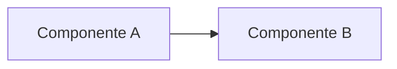

# Desafio 001 — Proposta Arquitetural

**Desafio:** Reserva de Salas  
**Status:** Rascunho — em elaboração  
**Autor:** Participante

---

## 1. Entendimento do problema e premissas

### 1.1 Objetivo do negócio

Gerenciar a reserva das salas de reuniões de uma empresa, garantindo que não existam conflitos entre as reservas, sendo possível cancelar reservas quando solicitado.

### 1.2 Requisitos confirmados

* Uma reserva fica associada ao usuário que a solicitou;
* Uma reserva de sala de reunião não pode sobrepor outra reserva previamente existente;
* Uma reserva poderá ser cancelada quando solicitado;
* Apenas o usuário responsável pela solicitação da reserva poderá cancelar a mesma;
* A disponibilidade das salas poderá ser consultada pelo usuário;
* O horário das reservas seguem múltiplos de 15 minutos;
* O período mínimo e máximo de uma reserva de sala é de 15 minutos e 2 horas, respectivamente;
* O salas podem ser reservadas dentro do período de segunda à sexta das 8h às 18h;
* Uma reserva pode ser realizada iniciando no minuto final de outra reserva. Por exemplo: uma reserva pode ser feita das 8h às 8h30 e uma seguinte das 8h30 às 8h45

### 1.3 Premissas adotadas

* O usuário informa o número de participantes da reunião e quais recursos precisa (hoje apenas video conferencia). O sistema interpreta a entrada e apresenta disponíveis para seleção (se é que existem).
* O sistema deve estar disponível em horários que existam funcionários trabalhando (consultar políticas de hora-extra e sobreaviso da empresa).
* Um mesmo usuário pode realizar quantas reservas for possível de acordo com a disponibildiade. O sistema não irá tratar isso e nem travar o usuário.
* Não lidaremos com criptografia de dados de login, ao menos nessa primeira iteração, onde usaremos credenciais de teste.

### 1.4 Questões em aberto

* Deveríamos permitir a desabilitação/reabilitação de determinadas salas para reserva, pensando, por exemplo, em períodos que a sala precisar de ser desativada para manutenção?

---

## 2. Visão geral da arquitetura

### 2.1 Abordagem proposta

<!-- Descreva a solução em alto nível e justifique sua abordagem. -->

### 2.2 Componentes e responsabilidades

<!-- Identifique os componentes e delimite suas responsabilidades. -->

### 2.3 Diagrama de arquitetura

<!-- Substitua o exemplo por seu desenho. -->

### 2.4 Experiência do usuário e frontend

#### 2.4.1 Acesso ao sistema

##### Jornada do usuário
1. O usuário inputa usuário (nesse momento, identidade teste) e senha e confirma
2. O usuário é direcionado para a tela inicial do sistema web.

##### Estados e feedback
* A confirmação só deve ser habilitada uma vez que ambos os campos estão (usuário e senha) estão devidamente preenchidos:
* No momento da confirmação, o sistema deve exibir uma mensagem informando adequadamente:
  * Caso o usuário não conste na base de cadastro;
  * Caso a senha esteja incorreta para o usuário informado;
  * Caso ocorra algum outro tipo de erro, deve ser exibida uma mensagem genérica de erro interno no sistema;
* Caso ocorra um erro de autenticação em alguma das chamadas do backend o cliente é redirecionado para a jornada de acesso ao sistema.

##### Responsabilidades
<strong>Frontend:</strong>
* Garante um limite máximo de caracteres nos inputs de usuário e senha;
* Realiza a chamada para o backend no evento da confirmação por parte do usuário;
* Traduz os cenários de excessão devolvidos pelo backend e os exibe de maneira adequada;
* Redireciona o usuário para a tela inicial do sistema web em caso de retorno positivo do backend.

<strong>Backend</strong>
1. Valida a entrada de dados no momento da confirmação, devolvendo erro de natureza do client caso esteja fora dos constraints definidos para os campos;
2. Valida a existencia do usuário devolvendo um erro de natureza do client caso o usuário não exista na base;
3. Valida que a senha informada corresponde à senha cadastrada para o usuário informado, devolvendo erro de natureza do client caso não sejam correspondentes.
4. Devolve um token de acesso com expiração que o frontend utiliza para realizar as chamadas subsequentes ao backend, onde essas por suas vezes renovam o token e sua expiração.

#### 2.4.2 Tela inicial logado

##### Jornada do usuário
2. O usuário visualiza na tela inicial uma das opções entre: "Minhas reservas" e "Consultar disponibilidade das salas";

##### Responsabilidades
<strong>Frontend:</strong>
1. Exibe adequadamente as opções para o cliente escolher.

#### 2.4.3 Tela de "Minhas reservas"

##### Jornada do usuário
1. O usuário seleciona "Minhas reservas"
2. O usuário visualiza a lista de reservas efetuadas por ele ordenadas pelo horario reservado de forma ascendente e em seguida pelo status (confirmada/recusada/cancelada). As informações presentes na listagem são: sala, data-horário, status da reserva, nessa ordem. Mais a direita nos elementos da listagem existirá um componente que permite direcionar para os "Detalhes da reserva".
3. Ao final da listagem, onde inicialmente seriam trazidos  

##### Estados e feedback
* Caso ocorra qualquer tipo de erro durante o carregamento da tela - exceto de autenticação - deve ser exibida uma mensagem genérica de erro interno no sistema; O cliente então permanece na tela inicial de seleção entre: "Minhas reservas" e "Consultar disponibilidade das salas".
* Caso ocorra um erro de autenticação em alguma das chamadas do backend o cliente é redirecionado para a jornada de acesso ao sistema.

##### Responsabilidades
<strong>Frontend:</strong>
1. Redireciona para a página "Minhas Reservas"
2. Realiza solicitação/solicitações ao backend para carregamento da página
3. Exibe a página uma vez que as informações retornadas pelo backend são carregadas

<strong>Backend:</strong>
1. Valida a autenticação do cliente. Devolvendo erro caso a mesma falhe;
2. Intercepta e processa as solicitações do frontend 
3. Exibe a página uma vez que as informações retornadas pelo backend são retornadas

## 3. Modelo de domínio e persistência

### 3.1 Entidades e conceitos do domínio

<!-- Identifique as entidades, atributos e relacionamentos relevantes. -->

### 3.2 Estratégia de persistência

<!-- Explique como e onde os dados serão armazenados, justificando as escolhas. -->

### 3.3 Regras e invariantes

<!-- Descreva as condições que devem permanecer verdadeiras no sistema. -->

---

## 4. Fluxos de negócio

### 4.1 Reserva bem-sucedida

<!-- Descreva o fluxo desde a solicitação até o resultado. -->

### 4.2 Reserva com conflito

<!-- Descreva o comportamento quando há conflito de horários. -->

### 4.3 Outros fluxos do escopo

<!-- Inclua outros fluxos confirmados como necessários. -->

### 4.4 Diagrama de sequência (opcional)

<!-- Adicione um diagrama Mermaid para o fluxo que desejar detalhar. -->

---

## 5. Consistência e concorrência

### 5.1 Garantias necessárias

<!-- Quais propriedades a arquitetura deve preservar? -->

### 5.2 Estratégia proposta

<!-- Como sua solução pretende garantir essas propriedades? -->

### 5.3 Cenários de concorrência

<!-- Considere solicitações simultâneas e outros cenários relevantes. -->

### 5.4 Estratégia de validação

<!-- Como demonstrar, por meio de testes ou experimentos, que as garantias são atendidas? -->

---

## 6. Trade-offs, riscos e dúvidas

### 6.1 Alternativas consideradas

<!-- Quais caminhos você considerou e por quê? -->

### 6.2 Trade-offs da proposta

<!-- Quais benefícios e custos acompanham suas escolhas? -->

### 6.3 Riscos identificados

<!-- Quais falhas, limitações ou dificuldades podem surgir? -->

### 6.4 Dúvidas para discussão com o mentor

<!-- Registre os pontos que você deseja investigar durante a revisão. -->

---

## Histórico de revisões

| Versão | Alteração |
|---|---|
| 0.1 | Proposta inicial |
